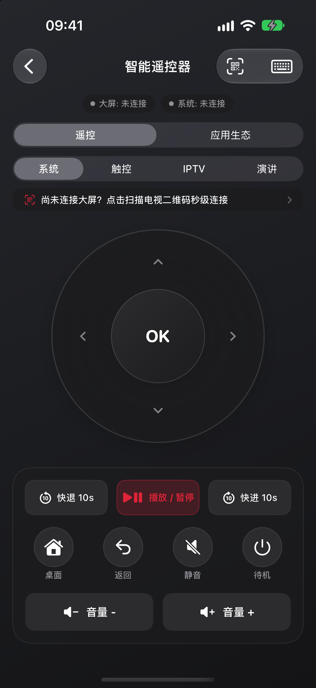
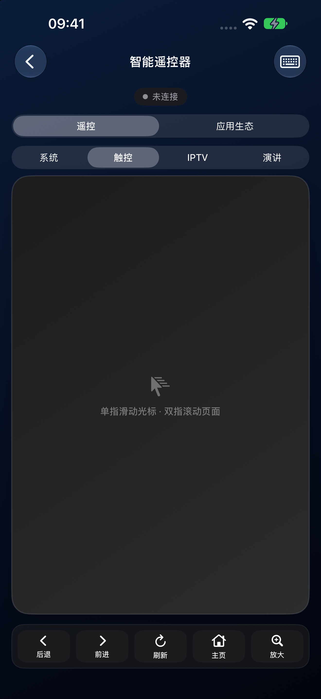
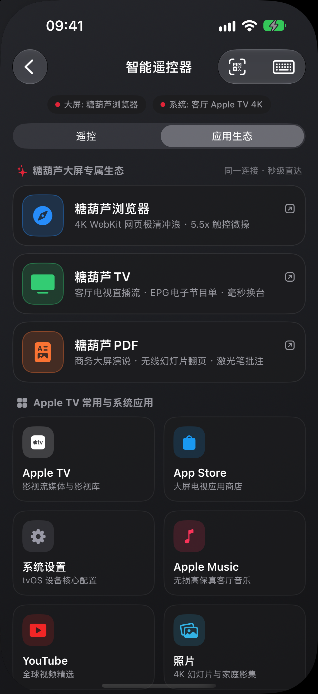
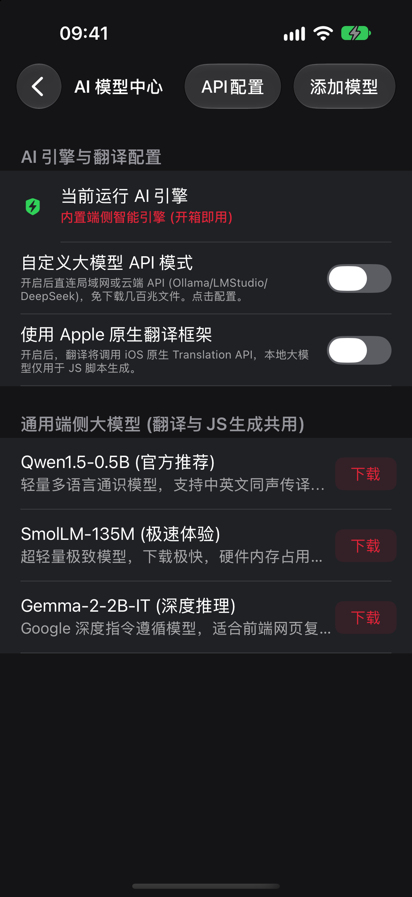
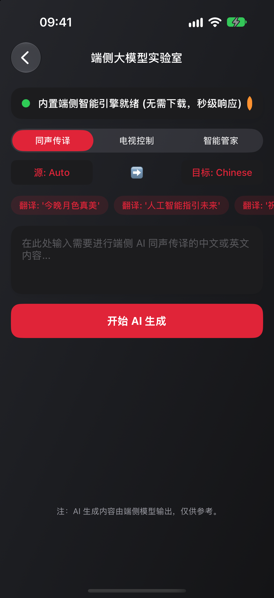
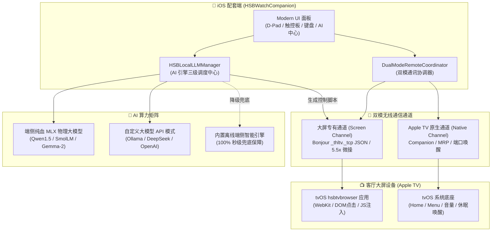

# 🍬 糖葫芦遥控器 (Tanghulu Smart Remote)


> **“端侧纯血 MLX 大模型矩阵 × Apple TV 双模原生遥控的客厅智能交互革命。”**
>
> 糖葫芦遥控器（`HSBRemoteBrowserTV` / `HSBWatchCompanion`）是一款专为 **Apple TV** 与客厅大屏打造的**双模无线遥控与端侧 AI 交互中枢**。深度融合 **Apple Silicon MLX 纯血端侧大模型**、**原生系统轮盘**、**5.5x 微操触控板**、**RTI 实时软键盘同步** 与 **客厅大屏多场景生态**，带来毫秒级响应的极致体验。

---

## 📸 精选界面展示 (Screenshots)

| 1. 原生系统轮盘与控制岛 | 2. 5.5x 微操触控板 | 3. 大屏应用生态直达 | 4. 端侧 MLX 模型中心 | 5. 端侧 AI 智能助手 |
| :---: | :---: | :---: | :---: | :---: |
|  |  |  |  |  |
| **270pt 原生质感轮盘<br>一体化影音控制岛** | **阻尼滑动 / 悬浮光标<br>网页控制坞与实时键盘** | **一键直达专属大屏生态<br>与 Apple TV 系统应用** | **三大模型断点续传<br>状态自愈与本地沙盒管理** | **同声传译 / TV JS 生成<br>客厅百科智能管家** |

---

## 🔥 核心特性与技术亮点 (Core Features)

### 🍎 1. Apple TV 原生双模协议架构 (Dual-Mode Native Protocol)
- **单一统一物理连接**：全面支持 Apple TV 原生 Companion 协议，局域网 Bonjour 毫秒级自动寻址与多端口敲门休眠唤醒；
- **智能硬件过滤**：严格解析 TXT 记录与 `rpFl` PIN 配对标志位，100% 自动过滤局域网内 Mac、iPhone 等非电视设备；
- **双模无缝流转**：系统基础按键（D-Pad、Home、Menu、播放、音量）直连原生系统层，浏览器 5.5x 微操、IPTV 换台与 PDF 演示走专有扩展通道，底层静默协同，操作零割裂。

### 🧠 2. 端侧纯血 MLX 大模型矩阵 (On-Device Edge AI Matrix)
把 iPhone 打造为客厅边缘 AI 推理算力中心，100% 本地离线运行，零云端隐私泄露风险：
- **Qwen1.5-0.5B (轻量通识)**：核心驱动【同声传译】，支持中英日韩多语言即时互译与字幕校对；
- **SmolLM-135M (极速响应)**：核心驱动【电视控制】，毫秒级生成大屏 DOM/WebKit 控制 JavaScript 脚本；
- **Gemma-2-2B-IT (深度推理)**：核心驱动【智能管家】，深度解答 Apple TV 连接排障与客厅百科问答；
- **多级容错与高可用**：模型未下载或显存受限时，100% 自动无缝降级至内置离线智能引擎；亦可一键切换自定义 API 模式（兼容 Ollama / DeepSeek / OpenAI）。

### 🚀 3. 客厅大屏多场景生态矩阵 (Ecosystem Matrix)
- **🌐 糖葫芦浏览器 (Tanghulu Browser)**：电视大屏 WebKit 极清冲浪，搭配 5.5x 微操触控板与快捷 JS 脚本芯片；
- **📺 糖葫芦 TV (IPTV 直播流)**：快捷频道切换、电子节目单 (EPG) 浏览与媒体全屏控制；
- **📄 糖葫芦 PDF (大屏演说神器)**：会议汇报利器，手机化身为激光笔与无线翻页器；
- **⌨️ RTI 实时软键盘同步**：手机直接调起系统键盘，打字瞬间推送到电视大屏输入框，终结大屏输入痛苦。

---

## 🏛️ 系统架构 (Architecture)



---

## ⚡ 快速开始与编译 (Quick Start)

### 环境要求
- **macOS**: 14.0+ (推荐 Apple Silicon M 系列芯片)
- **Xcode**: 15.0+ / 16.0+ / 27.0+ (适配 Device Hub)
- **SDK**: iOS 17.0+ / watchOS 10.0+ / tvOS 17.0+

### 编译构建
```bash
# 1. 克隆代码仓库
git clone https://github.com/never88gone/HSBRemoteBrowserTV.git
cd HSBRemoteBrowserTV

# 2. 使用 Xcode 打开主工程
open HSBWatchApp/HSBWatchApp.xcodeproj

# 3. 命令行静默编译检查
xcodebuild -project HSBWatchApp/HSBWatchApp.xcodeproj \
           -scheme HSBWatchCompanion \
           -configuration Debug \
           -destination 'generic/platform=iOS' \
           build
```

---

## 📄 许可与共建 (License & Community)

- 🐛 **Issue 报告**：欢迎提交 GitHub Issue 交流端侧 MLX 模型优化与功能反馈；
- 📬 **应用内反馈**：通过「设置 -> 关于糖葫芦」直连开发团队。

*—— Designed with ❤️ for the ultimate big-screen experience.*
